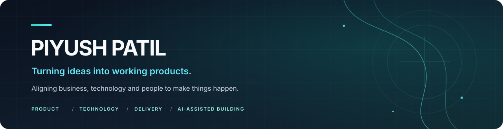
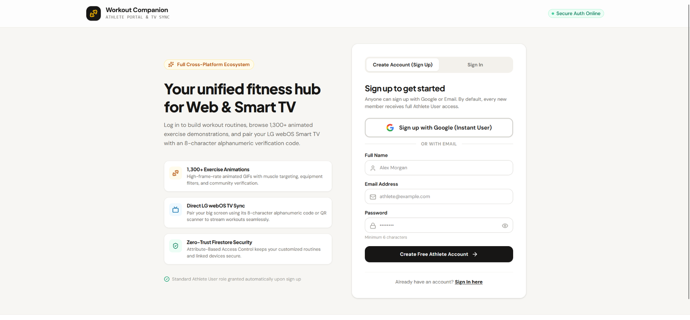
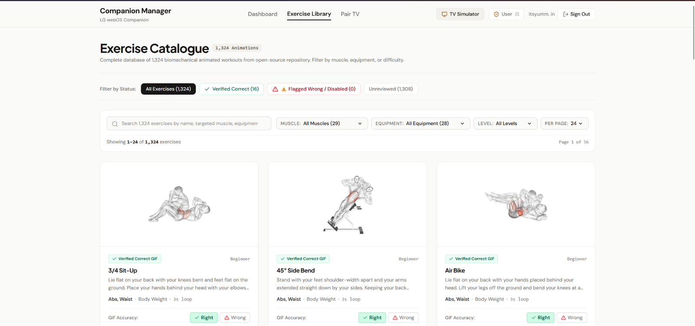

  

  
  
  

<h3 align="center">Aligning business, technology and people to make things happen.</h3>

  <em>Technology &amp; delivery leadership · Product execution · AI-assisted product building</em>

---

## A little about how I work

I enjoy the space where a business problem becomes a usable product: understanding the need, shaping the solution, translating it into requirements, aligning the people involved and improving the experience until it feels intuitive.

My background spans full-stack development, freelance software delivery, enterprise program management and early-stage product building. I move between business conversations and technical discussions, and I enjoy being close enough to the product to question workflows, challenge unnecessary complexity and help teams get things delivered.

**The work I naturally gravitate towards:** making complex things easier to use, turning ambiguity into an executable plan, bringing teams and stakeholders together, and using AI tools to explore and build ideas faster.

## What I bring

| Area | How I contribute |
|---|---|
| **Software & programme delivery** | Planning, execution coordination, stakeholder communication, issue resolution, delivery follow-through and handover. |
| **Product execution** | Requirements analysis, workflow definition, feature discussions, UX iteration and practical product decisions. |
| **Technical ownership** | Translating business needs into technical direction, architecture discussions and implementation plans. |
| **Team leadership** | Coordinating developers and testers, supporting recruitment, mentoring and resource planning. |
| **Quality & release readiness** | Manual testing coordination, UAT preparation, issue follow-up and deployment support. |
| **AI-assisted building** | Defining behaviour, guiding coding assistants, reviewing outputs, testing workflows and iterating on UX. |

---

## Selected work & experience

### 01 / WorkoutBuddy — cross-device home workout platform

<strong>PERSONAL PRODUCT BUILD · ACTIVE DEVELOPMENT</strong>

A home-workout companion that connects a web-based routine planner with an **LG webOS TV app**. Users create an account, pair their TV using a QR code or an eight-character code, build routines from individual exercises, configure intervals and play the routine on the television while working out.

<table>
  <tr>
    <td width="50%" align="center"><strong>Web companion</strong> </td>
    <td width="50%" align="center"><strong>Exercise library manager</strong> </td>
  </tr>
</table>

**Product flow**

1. Create an account in the web companion.
2. Install WorkoutBuddy on an LG webOS TV.
3. Pair the TV with the account by scanning its QR code or entering its pairing code.
4. Create a routine by selecting exercises and setting intervals.
5. Play the routine on the TV and use it as a guided home-workout companion.

**My contribution**

- Defined the initial product requirements and described expected application behaviour in detail.
- Used **VS Code with GitHub Copilot** for AI-assisted development, guiding implementation through prompts, feedback and repeated refinement.
- Spent significant time iterating on UX: exploring ways to reduce clicks and make workflows feel simple without making the interface visually cluttered or overly complex.
- Set up Firebase and tested the web-to-TV experience and application workflows.
- Researched exercise content and shaped the exercise-library experience.

**Technology**

`React` `Vite` `TypeScript` `Firebase Authentication` `Cloud Firestore` `Firebase Hosting` `LG webOS` `JavaScript`

**Current state — actively developing**

The core experience is mostly functional, but I am continuing to refine the UX and complete product-readiness work before user trials. The exercise source currently contains **1,324 candidate animation entries**, but titles, descriptions and GIF-to-exercise mappings need verification; I found mismatched animations and have not treated the catalogue as ready to publish. The next readiness steps include reviewing exercise content, creating banner and card imagery, and adding at least **10 curated starter routines** so first-time users have a useful experience from the beginning.

  
  

*One product, two connected applications and two repositories.*

---

### 02 / Industrial AI & software deployment — Ivory Coast

<strong>INDUSTRIAL TECHNOLOGY · DEPLOYMENT COORDINATION · 2026</strong>

Represented **ResoluteAI Software** during an on-site factory deployment programme involving five applications at different stages of development. The work combined factory-process discovery, stakeholder coordination, software delivery support and preparation of the hardware and server-side environment for AI data collection and model improvement.

| Application | Deployment focus |
|---|---|
| Appointment & Queue Management with Weighbridge | UAT and deployment support |
| Defect Detection | Hardware setup and AI deployment preparation |
| Trolley Level Verification | Hardware setup and AI deployment preparation |
| Predictive Maintenance — Industrial Machines | Hardware setup and AI deployment preparation |
| Warehouse Management System | Hardware setup, workflow, UX and data-flow work |

**My contribution**

- Coordinated deployment activity alongside a delegation of three engineers and helped keep deliverables moving.
- Worked with factory stakeholders to understand operational workflows, practical constraints and pain points.
- Supported execution strategy and issue resolution across the projects, with deeper software-side involvement in the Warehouse Management System, particularly workflows, UX and data flows.
- Helped refine features and application behaviour to better match the factory's requirements.
- Supported the team in preparing the deployment environment and keeping work on track.

**Position at departure**

Hardware for the AI-focused workstreams was in place, and selected server-side software components had been deployed to support data collection, monitoring, recording, analysis and subsequent model training and updates. The on-site foundation was prepared for continued remote completion towards the planned November deployment. Model accuracy improvement and final completion were subsequent activities—not outcomes claimed for the on-site visit.

*The engineers handled most IoT calibration, device configuration and hardware-to-application connectivity. My contribution centred on coordination, factory-facing communication, execution strategy, software workflows and delivery support.*

---

### 03 / IQnaut — EdTech platform

<strong>INDEPENDENT PRODUCT ENGAGEMENT · APRIL–NOVEMBER 2025</strong>

Worked as the primary technical stakeholder alongside a non-technical founder, helping turn the product direction into an executable technical and delivery plan.

**My contribution**

- Designed the platform architecture and guided technical decisions.
- Supported recruitment and coordinated a team of **3–5 people**.
- Contributed to project planning and execution, UX coordination and manual testing.
- Worked across the product's web, backend, mobile, database, media-storage and cloud architecture.
- Groomed a manager to take over resource management and ongoing project coordination.

**Technology landscape**

`React.js` `Vite` `Python` `PHP` `SQLite` `MySQL` `Firestore` `Flutter` `Google Cloud Platform` `Cloudinary`

**Position at handover:** the product was working, UAT was still pending, and initial business-development activities had begun. The manager I had groomed was taking care of resources and ongoing project coordination.

---

### 04 / ResoluteAI Software — Program Manager

<strong>SEPTEMBER 2022–APRIL 2025 · ENTERPRISE SOFTWARE & PRODUCT DELIVERY</strong>

Managed software initiatives across requirements, planning, development coordination, testing, client communication, deployment and support. Coordinated developers and testers across delivery work, with team sizes reaching **20+ people**.

**Selected initiatives**

- **Facegenie** — computer-vision product; involved end to end across discovery, planning, execution, launch and support.
- **Cairn / Vedanta** — LLM-based chat application.
- **GMR** — LLM chat and health-tracking application, employee tracking and maintenance-record digitisation.
- **Welspun / Milky Mist** — computer-vision shelf analytics.
- **Welspun** — drone-video analysis and moderation.
- **Gokuldas** — leave application with IVR and WhatsApp.
- **Biocon / Syngene** — visitor-management application.
- Other initiatives included security management, attendance management and BPMS projects for RIADA and MMRDA.

My role involved translating business requirements into executable work, coordinating cross-functional teams, working with clients and stakeholders, resolving delivery issues and moving software initiatives towards release and operational use.

---

### 05 / Earlier foundation — development & freelance delivery

**Freelance Full-Stack Application Developer · 2017–2022**  
Managed client engagements from acquisition and requirements gathering through estimation, negotiation, development, coordination of freelance resources, delivery, deployment and support.

**Full-Stack Web Developer · Technobase Solutions · 2016–2017**  
Worked on PHP-based web application development, testing and deployment, including BPMS projects for RIADA and MMRDA.

---

## How I build with AI

I enjoy software development most when I can explore different ways to solve a problem and keep refining the experience. The part I particularly enjoy is **UX iteration**: reducing unnecessary clicks, simplifying workflows and making an application feel natural without making it look or behave like a stripped-down tool.

For me, AI coding tools are collaborators in an iterative build process:

`Frame the problem` → `Define expected behaviour` → `Prompt and generate` → `Review` → `Test` → `Refine the UX` → `Repeat`

**Development environment and tools I've used**

- **Primary AI-assisted coding workflow:** VS Code + GitHub Copilot, including WorkoutBuddy.
- **Other AI development tools explored:** Claude, Google Antigravity, OpenAI Codex and Google AI Studio.
- **Creative experimentation:** Canva AI and Google Flow for visual assets, image enhancement and short-video exploration.

I don't present every tool as an area of expert proficiency; these are tools I have explored and applied in different workflows.

## Technical working areas

| Working mode | Technologies |
|---|---|
| **Independent troubleshooting** | `PHP` `Python` `MySQL` `HTML` `CSS` |
| **Debugging** | `JavaScript` `PHP` `Python` `Firebase` `Firestore` `MySQL` `SQLite` `HTML` `CSS` |
| **AI-assisted implementation** | `JavaScript` `PHP` `Python` `Firebase` `Firestore` `MySQL` `SQLite` `Google Cloud Platform` `HTML` `CSS` |
| **Project architecture exposure** | `React` `Vite` `Flutter` `LG webOS` `Firebase` `GCP` `Cloudinary` |

These labels describe how I currently work with the technologies—not a claim that I am a specialist or daily hands-on engineer in every item.

---

## 🧪 B2C Product Lab — what I want to explore next

I want this profile to evolve as I build and publish small, real products. I am interested in experimenting across **education, food, health and travel**; I haven't committed to one category and would rather follow interesting problems than force a niche too early.

As new builds become real, I'll add a concise showcase with the problem, intended user, screenshots, my contribution, tools used, current stage and links to the code or demo. I prefer a few honest, working experiments over a long list of hypothetical projects.

For the structure I use when adding a new project, see [`PROJECT_CARD_TEMPLATE.md`](PROJECT_CARD_TEMPLATE.md).

---

## What I'm open to

I'm open to interesting opportunities and collaborations around **product execution, technology and programme delivery, software implementation, AI-enabled products and early-stage product building**. I enjoy working with people who want to turn practical problems into useful products.

  
  

Build with intent. Make it useful. Keep improving.

